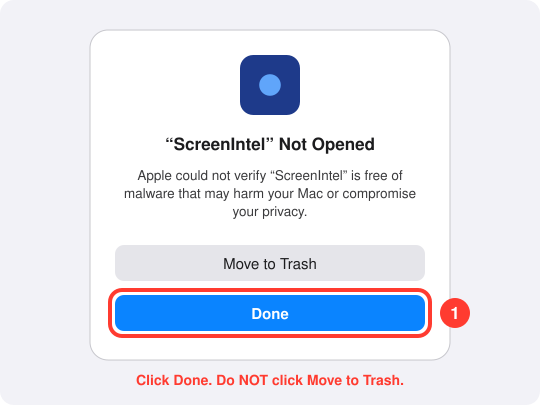
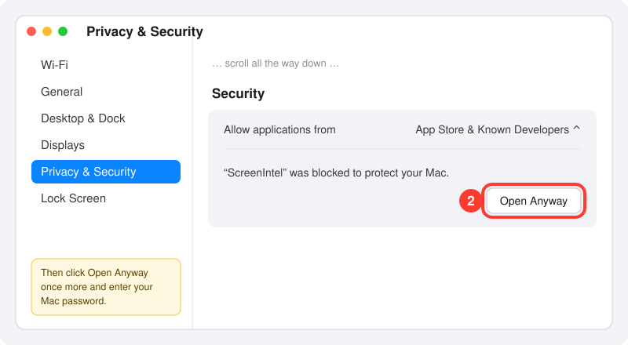
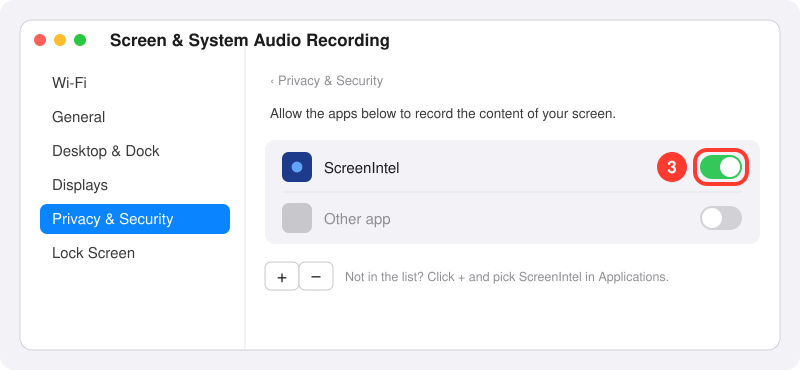
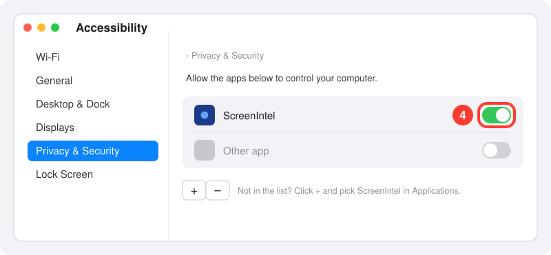
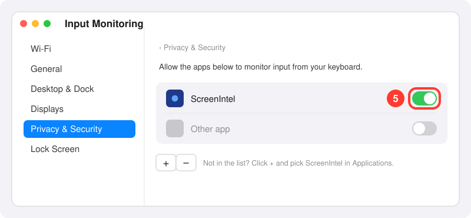

<div align="center">

# 🧠 Screen Intel

**Press one shortcut. Get the answer.**

Screen Intel looks at your screen, finds the quiz question, and shows the shortest correct answer in a small see-through overlay that floats on top of everything.

[](https://github.com/Greejv/ScreenIntel/actions/workflows/build.yml)
[](https://github.com/Greejv/ScreenIntel/releases/latest)


[**⬇️ Download**](https://github.com/Greejv/ScreenIntel/releases/latest) · [Get an API key](#-step-1-get-your-free-gemini-api-key) · [Install](#-step-2-install) · [How to use](#-step-3-use-it) · [Help](#-troubleshooting) · [Developers](#-for-developers)

</div>

---

## ✨ What it does

| | |
|---|---|
| ⌨️ **One shortcut** | Press `Ctrl` + `Shift` + `Q` (Mac: `⌃` + `⌥` + `Q`) and the whole screen is sent to Google Gemini. |
| 🎨 **Make it yours** | Pick the font, size and color of the answer, even a color picked straight from your screen. |
| 🎯 **Short answers** | Just the letter, the word, or one short sentence. No explanations. |
| 👻 **Invisible window** | Only the answer text is visible. No border, no background, always on top. |
| 🧩 **Many question types** | Multiple choice, fill in the blank, dropdowns, drag and drop, matching, open questions. |
| 🧹 **Ignores clutter** | Browser tabs, taskbar and other windows around the question don't confuse it. |
| 🔒 **Your key stays with you** | Your API key is kept in Windows Credential Manager or the macOS Keychain, never in a plain file, and never leaves your computer except to talk to Gemini. |

**Example answers:**

```
B
Paris | 1789 | Napoleon
1-C, 2-A, 3-B
Photosynthesis turns light into chemical energy.
```

---

## 🔑 Step 1: Get your free Gemini API key

Screen Intel uses Google's Gemini AI. You need your own key. It's free and takes about a minute.

1. Go to **<https://aistudio.google.com/apikey>** and sign in with your Google account.
2. Click **Create API key**.
3. Click **Copy**. Your key looks something like `AIzaSy...` (about 39 characters).
4. Keep it somewhere safe for the next step.

> [!WARNING]
> Treat your key like a password. Don't share it or post it online.

---

## 📦 Step 2: Install

### 🪟 Windows

1. Open the [**latest release**](https://github.com/Greejv/ScreenIntel/releases/latest) and download **`ScreenIntel.exe`**.
2. Move it somewhere permanent, for example a `ScreenIntel` folder in Documents.
3. Double-click **`ScreenIntel.exe`**.
4. If Windows shows **"Windows protected your PC"**, click **More info** → **Run anyway**. This appears because the app isn't code-signed.
5. The **welcome tour** opens. Click through it and **paste your API key** when it asks.
6. You'll see **"Ready. Ctrl+Shift+Q to answer."** in the top-left corner. 🎉

A lens icon appears in the system tray (bottom-right, you may need to click `^`). Click it to show or hide the answer; right-click it for **Settings…**, **Welcome tour**, **Restart** and **Quit**. Or press `Ctrl` + `Shift` + `X` to turn it off.

> [!TIP]
> **Start automatically with Windows:** press `Win` + `R`, type `shell:startup`, press Enter, and put a shortcut to `ScreenIntel.exe` in that folder.

### 🍎 macOS (Apple Silicon: M1, M2, M3, M4 and newer)

Setting up on a Mac takes about 3 minutes and you only do it once. Because ScreenIntel is a free app that isn't signed by Apple, macOS blocks it the first time, and it needs two or three permissions before it can see the screen and hear the shortcuts. Follow the steps in order.

> [!NOTE]
> The pictures below are simple drawings to show you where to click. Your Mac may look slightly different depending on your macOS version, but the names of the buttons are the same.

#### Part A: Download

1. Open the [**latest release**](https://github.com/Greejv/ScreenIntel/releases/latest) and download **`ScreenIntel-mac.zip`**.
2. Open your **Downloads** folder and double-click **`ScreenIntel-mac.zip`**. A **`ScreenIntel`** app appears next to it.
3. Drag **`ScreenIntel`** into your **Applications** folder (in the Finder sidebar).

#### Part B: Get past the "can't be verified" popup

4. Open **Applications** and double-click **ScreenIntel**. macOS shows a popup saying it **could not verify** the app. This is expected. Click **Done** (on older macOS it says **Cancel** or **OK**). Do **not** click **Move to Trash**.

   

5. Open **System Settings** (click the Apple menu in the top-left corner → **System Settings**) and click **Privacy & Security** in the left sidebar.
6. Scroll **all the way down** to the **Security** section. You'll see **"ScreenIntel" was blocked to protect your Mac.** Click **Open Anyway**.

   

7. A new popup appears. Click **Open Anyway** again and enter your Mac password (or use Touch ID). ScreenIntel now opens, and from now on it opens normally.

> [!TIP]
> **On macOS 14 Sonoma or older** there's a shortcut: in **Applications**, **right-click** (or `Control`-click) **ScreenIntel**, choose **Open**, then click **Open** in the popup. On macOS 15 Sequoia and newer this no longer works, so use steps 5 to 7.

<details><summary>Still blocked? Use one Terminal command instead</summary>

Open **Terminal** (press `Cmd` + `Space`, type `Terminal`, press Enter), paste this line and press Enter:

```bash
xattr -dr com.apple.quarantine /Applications/ScreenIntel.app
```

This removes the "downloaded from the internet" flag, so macOS opens the app without asking. Then double-click ScreenIntel again.
</details>

#### Part C: Add your API key

8. The **welcome tour** opens. Click through it and paste your API key from [Step 1](#-step-1-get-your-free-gemini-api-key) when it asks. Its **Open settings** buttons take you straight to the permission pages below.

#### Part D: Allow the permissions

ScreenIntel needs permission to **see your screen** (to read the question) and to **listen for its shortcuts**. All three switches are in **System Settings → Privacy & Security**. macOS may also pop up a request for some of them on its own the first time you press a shortcut; if it does, click **Open System Settings** and continue below.

9. **Screen Recording** (so it can see the question): in **Privacy & Security**, click **Screen & System Audio Recording** (called **Screen Recording** on older macOS) and turn on **ScreenIntel**. If macOS asks to **Quit & Reopen**, click **Later**; you'll restart the app at the end.

   

10. **Accessibility** (so the shortcuts work): go back to **Privacy & Security**, click **Accessibility** and turn on **ScreenIntel**.

    

11. **Input Monitoring** (also for the shortcuts): go back to **Privacy & Security**, click **Input Monitoring** and turn on **ScreenIntel**. If ScreenIntel isn't listed there, that's fine on your macOS version; skip this step.

    

> [!TIP]
> **ScreenIntel isn't in the list?** Click the **+** button under the list, open **Applications**, select **ScreenIntel** and click **Open**. Then turn its switch on.

#### Part E: Restart and test

12. **Quit ScreenIntel** (`⌃` + `⌥` + `X`, that's Control + Option + X, or menu bar icon → **Quit Screen Intel**) and **open it again** from Applications. Permissions only take effect after a restart.
13. You'll see **"Ready. ⌃⌥Q to answer."** in the top-left corner. Open a quiz and press **`⌃` + `⌥` + `Q`** (Control + Option + Q) to test it. 🎉

Screen Intel puts a **lens icon in the menu bar** (top right). Click it for **Show / hide answer**, **Settings…**, **Welcome tour**, **Restart** and **Quit**. Clicking the Dock icon or `Cmd` + `,` also opens Settings. Turn it off with `⌃` + `⌥` + `X`, from the menu bar icon, or with `Cmd` + `Q`.

If the shortcut does nothing or the answer is about the wrong thing, see [Troubleshooting](#%EF%B8%8F-troubleshooting). Apple's own guides with real screenshots: [open an app from an unknown developer](https://support.apple.com/guide/mac-help/open-a-mac-app-from-an-unknown-developer-mh40616/mac), [allow screen recording](https://support.apple.com/guide/mac-help/control-access-screen-system-audio-recording-mchld6aa7d23/mac), [allow accessibility apps](https://support.apple.com/guide/mac-help/allow-accessibility-apps-to-access-your-mac-mh43185/mac).

---

## 🚀 Step 3: Use it

1. Open your quiz so the question is visible on screen.
2. Press **`Ctrl` + `Shift` + `Q`** (Mac: **`⌃` + `⌥` + `Q`**, that's Control + Option + Q).
3. You'll see `...` while it thinks, then the answer appears, usually within 2 to 4 seconds.

### ⌨️ Shortcuts

| Windows | Mac | What it does |
|:--|:--|:--|
| `Ctrl` + `Shift` + `Q` | `⌃` + `⌥` + `Q` | 📸 Read the screen and answer |
| `Ctrl` + `Shift` + `D` | `⌃` + `⌥` + `D` | 📝 Detailed answer: the answer plus a short explanation |
| `Ctrl` + `Shift` + `F` | `⌃` + `⌥` + `F` | 🧮 Just the formula needed to calculate it |
| `Ctrl` + `Shift` + `G` | `⌃` + `⌥` + `G` | 🪜 Short step-by-step working, ending with the answer |
| `Ctrl` + `Shift` + `H` | `⌃` + `⌥` + `H` | 👁️ Hide / show the answer |
| `Ctrl` + `Shift` + `↑` | `⌃` + `⌥` + `=` | 🔠 Bigger text |
| `Ctrl` + `Shift` + `↓` | `⌃` + `⌥` + `-` | 🔡 Smaller text |
| `Ctrl` + `Shift` + `R` | `⌃` + `⌥` + `R` | 🔄 Restart the app |
| `Ctrl` + `Shift` + `X` | `⌃` + `⌥` + `X` | ⏻ Turn the app off |

These are the defaults. On Mac they use **Control + Option** (`⌃⌥`), which no macOS shortcut uses: `Cmd` combinations belong to the app in front, and `Control` + letter moves the cursor in text fields. You can change any of them in **Settings**.

### 🖱️ Moving the answer

Click directly **on the text** and drag it wherever you like. Clicks on the empty space around the text go straight through to the window behind it. On Windows, clicking the answer never takes focus away from your quiz page.

### ⚙️ Settings

Open Settings from the **tray icon** (Windows) or the **menu bar icon** / Dock icon / `Cmd` + `,` (Mac). It has four pages:

| Page | What you can change |
|:--|:--|
| **General** | Your **Gemini API key** (click **Show** to check it, or **Get a free key**) and the **Model**. Leave the model on the default unless it stops working. |
| **Appearance** | The answer's **font** (system font or a few others), **size** (4 to 72) and **color**: pick a swatch, choose **Custom…**, or click **Pick a color from the screen** and then click any pixel on your screen (a magnifier shows exactly which one). On Windows, turn **Dark outline** off to drop the thin dark edge around the text (it helps light text on white pages, so it's on by default). A live preview shows the result, and the page scrolls. |
| **Background** | Where to find the running app, **Show welcome tour**, **Restart** and **Quit**. |
| **Shortcuts** | Click the box next to an action and **press the keys** you want, e.g. `Ctrl` + `Alt` + `T`. Use at least one of Ctrl, Shift, Alt/Option or Win/Cmd plus a letter, number, arrow, `=`, `-`, space or F1–F12. `Esc` cancels. Screen Intel refuses system shortcuts (like `Ctrl` + `C`, `Win` + `D` or `Cmd` + `Space`), shortcuts used twice, and on Windows any shortcut another app already owns. **Reset to defaults** restores the defaults. Your shortcuts are paused while Settings is open. |

Click **Save** and the changes apply immediately, no restart needed.

### 📖 How to read the answers

| Question type | Example answer |
|:--|:--|
| Multiple choice | `B` |
| Several correct options | `A, C` |
| Fill in the blanks / dropdowns / drag and drop | `mitochondria \| ATP` (one per blank, in order) |
| Matching / ordering | `1-C, 2-A, 3-B` |
| Open question | One short sentence |
| More than one question on screen | One numbered line per question |
| No question found | `?` |
| Formula (`Ctrl` + `Shift` + `F`) | `v = s / t` (one formula per line, no numbers) |
| Steps (`Ctrl` + `Shift` + `G`) | `1. v = s / t` · `2. v = 100 / 20 = 5` · `Answer: 5 m/s` |

---

## 🛠️ Troubleshooting

<details>
<summary><b>"No Gemini API key. Open Settings from ..."</b></summary>

Open **Settings** (tray icon on Windows, menu bar icon on Mac), paste your key and click **Save**.
</details>

<details>
<summary><b>"Error: ... API key not valid"</b> or I want to change my key</summary>

Open **Settings**, paste the correct key and click **Save**. Make sure you copied the whole key from <https://aistudio.google.com/apikey>.
</details>

<details>
<summary><b>"Error: ... 503 / UNAVAILABLE" or "429 / RESOURCE_EXHAUSTED"</b></summary>

Google's servers are busy or you hit the free limit. The app already retries automatically. Wait a minute and press the shortcut again.
</details>

<details>
<summary><b>"Shortcut already used by another app: ..."</b></summary>

Another program is using that shortcut (common ones: screenshot tools, game overlays, Discord). Open **Settings** and pick a different shortcut for it.
</details>

<details>
<summary><b>Nothing happens when I press the shortcut (Mac)</b></summary>

Check **System Settings → Privacy & Security → Accessibility** and **Input Monitoring**, make sure **ScreenIntel** is turned on, then quit and reopen the app. Since v1.6.0 the Mac shortcuts use **Control + Option** (`⌃⌥Q`), not Control + Shift.
</details>

<details>
<summary><b>The answer is about the wrong thing (Mac)</b></summary>

Make sure **Screen Recording** is allowed for ScreenIntel. Without it macOS only gives the app your wallpaper. On Mac only the main display is captured, so keep the quiz on your main screen.
</details>

<details>
<summary><b>I can't see the answer text</b></summary>

Press `Ctrl` + `Shift` + `H` (Mac: `⌃` + `⌥` + `H`) in case it's hidden, and `Ctrl` + `Shift` + `↑` (Mac: `⌃` + `⌥` + `=`) to make it bigger. It starts in the top-left corner of the main screen. If you picked a dark color in **Settings → Appearance**, it may be hard to see on a dark page.
</details>

<details>
<summary><b>The app takes a few seconds to start (Windows)</b></summary>

That's normal. The single `.exe` unpacks itself on each launch.
</details>

---

## ⚙️ Advanced

<details>
<summary><b>Where settings are stored</b></summary>

| | Location |
|---|---|
| Windows | `%APPDATA%\ScreenIntel\.env` |
| macOS | `~/Library/Application Support/ScreenIntel/.env` |

Your **API key** is not in this file: it's stored in **Windows Credential Manager** (entry `ScreenIntel`) or the **macOS Keychain** (item `ScreenIntel`), encrypted by your system and readable only when you're signed in. Older versions kept it in the file; the first start of v1.7.0 moves it over and blanks it in the file. On macOS the settings file is readable only by your user. If no credential store is available, the key stays in the settings file.

The Settings window writes this file. You can also put a `.env` file next to the app; anything the Settings window saved takes priority over it, and environment variables beat both. Available settings:

```env
GEMINI_API_KEY=your_key_here         # only in a .env next to the app, or when there's no credential store
GEMINI_MODEL=gemini-3.5-flash-lite   # optional, this is the default
FONT_SIZE=14                         # optional, 4 to 72
FONT_FAMILY=Georgia                  # optional, empty = system font
TEXT_COLOR=#ffffff                   # optional, answer color
TEXT_OUTLINE=1                       # optional, 0 = no dark edge around the text (Windows)
ONBOARDED=1                          # set after the welcome tour; remove it to see the tour again
```
</details>

<details>
<summary><b>What the app leaves on your computer, and how to uninstall</b></summary>

Screen Intel installs nothing. It runs no services, adds no startup entries or registry keys, and nothing of it keeps running after you turn it off (`Ctrl` + `Shift` + `X` / `⌃` + `⌥` + `X`, tray or menu bar → Quit, or `Cmd` + `Q`).

It keeps only two things: your API key in the credential store and the settings file from the table above (on macOS, macOS itself also keeps the app's permissions and some window state). While it runs on Windows, the `.exe` unpacks itself into a temporary `_MEI...` folder in `%TEMP%`, which is deleted automatically when the app turns off. It's only left behind if the app is force-killed (e.g. from Task Manager).

Every build is checked automatically: the app must start, turn itself off, exit cleanly and leave no temporary files.

**To uninstall:** open **Settings → Background → Uninstall Screen Intel…**. It deletes your API key, your settings folder and, on macOS, the app's preferences, saved window state and its Screen Recording / Accessibility / Input Monitoring permissions. Then it shows you where `ScreenIntel.exe` (or `ScreenIntel.app`) is so you can delete it. If you put a `.env` file next to the app yourself, delete that too.
</details>

<details>
<summary><b>Run from source</b></summary>

Requires Python 3.10+.

```bash
git clone https://github.com/Greejv/ScreenIntel.git
cd ScreenIntel
pip install -r requirements.txt
python main.py
```

Build the Windows `.exe` yourself with `.\build.bat` (output: `dist\ScreenIntel.exe`).

Run the tests with `pip install pytest && pytest tests`.
</details>


---

## 👩‍💻 For developers

Want to fix something or add a feature? Start here:

| Doc | What's in it |
|:--|:--|
| [Developer guide](CONTRIBUTING.md) | Setup, code guidelines, testing checklist, how to release |
| [Architecture](docs/ARCHITECTURE.md) | How the modules fit together, threading, configuration, CI |
| [Roadmap](docs/ROADMAP.md) | What's planned next |
| [CLAUDE.md](CLAUDE.md) | Instructions for AI coding assistants |

New versions are released by bumping the [`VERSION`](VERSION) file and pushing to `main`: CI tests, builds Windows and macOS, and publishes the release.

---

<div align="center">
<sub>Screen Intel sends a screenshot of your screen to Google Gemini each time you press the shortcut. Nothing is sent otherwise. Use it responsibly and follow the rules of your school or platform.</sub>
</div>
